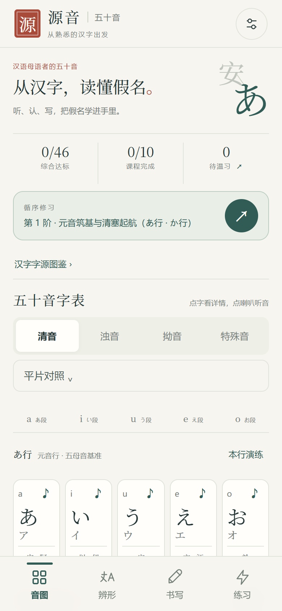
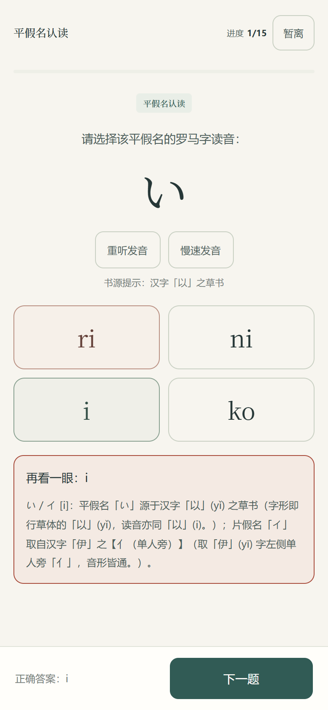
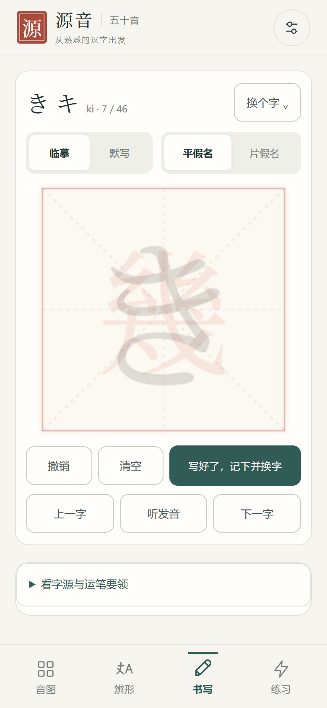
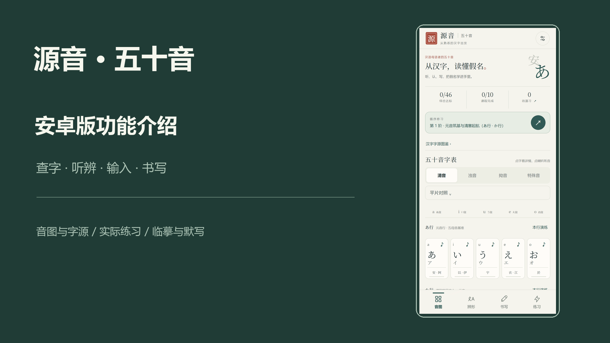

# 源音·五十音

**从熟悉的汉字出发，听、认、写日语假名。**

### [下载 APK · v3.0.0](https://github.com/Beatrice-III/genyin-gojuon/releases/download/v3.0.0/Genyin-Gojuon-3.0.0.apk)　[观看上手介绍](https://github.com/Beatrice-III/genyin-gojuon/releases/download/v3.0.0/Genyin-Gojuon-introduction-1080p.mp4)　[全部发布文件](https://github.com/Beatrice-III/genyin-gojuon/releases/latest)　[下载源码包](https://github.com/Beatrice-III/genyin-gojuon/releases/download/v3.0.0/Genyin-Gojuon-3.0.0-source.zip)

Android 7.0 及以上 · 安装包约 6.2 MiB · 364 条内置离线发音 · 无需另装日语引擎 · 不注册

下载 APK 就能安装使用；下面折叠的开发步骤只给需要修改源码的人。

<table>
  <tr><th>点字听音</th><th>动手练习</th><th>临摹与默写</th></tr>
  <tr>
    <td></td>
    <td></td>
    <td></td>
  </tr>
</table>

### 看一遍怎么用

一位介绍者按操作顺序演示音图查字、辨形、作答与错题重练、听音、罗马字输入、临摹默写和进度备份。点击封面观看约三分钟的普通上手介绍。

[](https://github.com/Beatrice-III/genyin-gojuon/releases/download/v3.0.0/Genyin-Gojuon-introduction-1080p.mp4)

## 想练什么，就从这里开始

| 想练什么 | 怎么操作 |
| --- | --- |
| 看懂并记住一个假名 | 打开「音图」，点假名看字卡，对照平假名、片假名和汉字字源；点喇叭听音，没听清可以慢速重听。 |
| 分清长得像的字 | 打开「辨形」，选一组易混假名，比较关键笔画，再进入专项练习。 |
| 听声音选出假名 | 打开「练习」，选听音辨字，听正常或慢速发音后作答。 |
| 认平片假名、自己写读音 | 在「练习」里选择认读、平片对应或罗马字输入；也可以用综合练习换着练。 |
| 把错题真正练回来 | 答错先看解释，错题会穿插重现；一轮结束后重新练错题，也能从薄弱项开始。 |
| 从照着写到独立写 | 打开「书写」，先跟底稿临摹，再藏起底稿默写，最后揭晓范字进行对照。 |
| 按顺序学，或只练不熟的部分 | 从「练习」进入十阶课程；需要自己安排时，选择题型、范围和题量。 |

查字后可以直接去练或写，返回时接着看原来的位置。练习中途退出会先暂停，回来可以继续原题。

## 安装只需三步

1. 在安卓手机上[下载 APK](https://github.com/Beatrice-III/genyin-gojuon/releases/download/v3.0.0/Genyin-Gojuon-3.0.0.apk)。
2. 点开下载的文件，按系统提示允许当前浏览器或文件管理器安装应用。
3. 安装后打开「源音·五十音」，直接开始听、认、写和练习。

**已经装过旧版：直接覆盖安装，不要先卸载。** 正式版沿用原包名和签名，保留本机学习记录。

## 备份与换手机

点右上角设置 →「导出学习记录」，把 JSON 文件保存好。新手机安装 App 后，在同一处点「导入学习记录」，选中备份并确认。导入会替换当前进度，App 会保留一份导入前的本机备份。

学习记录保存在本机，不用注册账号。换手机或卸载前记得先导出。

<details>
<summary><strong>给开发者：源码、构建、验证与许可</strong></summary>

### 源码和运行方式

Release 的 `Genyin-Gojuon-3.0.0-source.zip` 对应正式 `v3.0.0` 应用标签。当前 main 分支另外包含更新后的普通上手视频工程、18 段旁白和复现说明；需要全部现行工程时，可[下载当前完整源码](https://github.com/Beatrice-III/genyin-gojuon/releases/download/v3.0.0/Genyin-Gojuon-current-source.zip)，或使用 main 分支。

应用使用本地 HTML/CSS/JavaScript，Android Java 宿主负责系统后退、窗口适配、文件备份与本地资源桥接。支持 Android 7.0（API 24）及以上，目标 API 36。

| 路径 | 内容 |
| --- | --- |
| `index.html`、`css/`、`js/` | 界面、教学数据、题目、书写、音频、进度与复习逻辑 |
| `android/src/`、`android/res/` | Android 宿主和原生资源；桥接 API 见 [android/README.md](android/README.md) |
| `assets/audio/` | 完整语料清单、文件映射与本地录音生成位置 |
| `assets/fonts/` | OFL 字体子集与许可 |
| `tools/` | 音频生成、验证、录制及视频制作工具 |
| `docs/images/` | README 中的界面截图 |

### 从源码构建 APK

**只想安装使用，请下载上面的正式 APK，无需运行这些命令。**

构建环境：Python 3、Node.js、JDK 17、Android SDK Platform 36、Build Tools 36.0.0，以及 FFmpeg（含 ffprobe）。脚本直接使用 Android 官方构建工具，无需 Gradle。

公开源码包含完整语音清单和生成脚本，不包含 Microsoft 服务生成的 MP3。开发构建先联网生成一次课程录音：

```powershell
node tools/audio_inventory.cjs
python -m pip install edge-tts
# 如果 FFmpeg 不在脚本默认位置，请设置本机路径：
# $env:FFMPEG = 'D:/tools/ffmpeg/bin/ffmpeg.exe'
python tools/prepare_course_audio.py
python tools/publish_source.py --check --require-audio
python android/build_apk.py --debug
```

`--debug` 生成独立包 `com.genyin.gojuon.dev` 和临时开发签名，可与正式版并存。SDK、JDK 位置和输出路径可通过构建参数修改，详见 [Android 构建说明](android/README.md)。正式版构建需自己的签名密钥和 `GENYIN_KEYSTORE_PASSWORD` 环境变量；私钥与密码不公开。交付件位于 `outputs/`，临时资料位于 `work/`。

网页预览可执行 `python -m http.server 8766`，然后打开 `http://127.0.0.1:8766`。不依赖浏览器的学习逻辑检查为 `node tools/verify_learning_logic.cjs`，公开文件检查为 `python tools/publish_source.py --check`。

### 语音与许可

APK 的 364 条固定读音使用 Microsoft Edge TTS：日语 Nanami、普通话 Xiaoxiao。**Qwen3-TTS 仅用于介绍视频旁白，不运行在 APK 中。** 可选视频配音工具见 [Qwen 配置](tools/qwen_README.md)；模型权重不在仓库内。

项目代码与文档采用 [MIT](LICENSE)，字体采用 SIL OFL 1.1。Microsoft 服务语音输出不纳入根 MIT 许可；Qwen 上游模型和代码采用 Apache-2.0。详细来源见 [NOTICE](NOTICE)、[THIRD_PARTY.md](THIRD_PARTY.md) 和 [音频说明](assets/audio/LICENSE)。

欢迎通过 [Issues](https://github.com/Beatrice-III/genyin-gojuon/issues) 反馈手机型号、Android 版本和可复现步骤，或提交附可靠资料的内容勘误。教学数据的来源与校订范围见 THIRD_PARTY.md。

</details>
